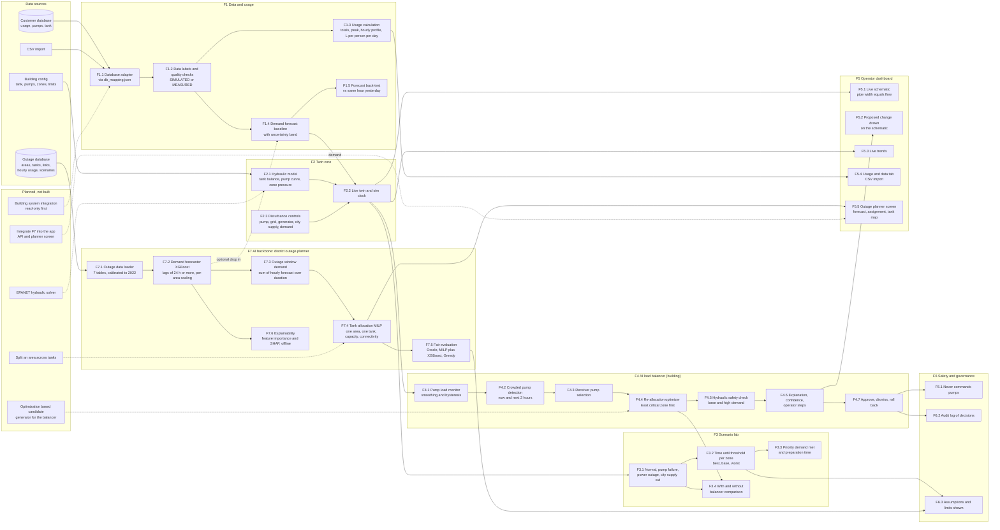
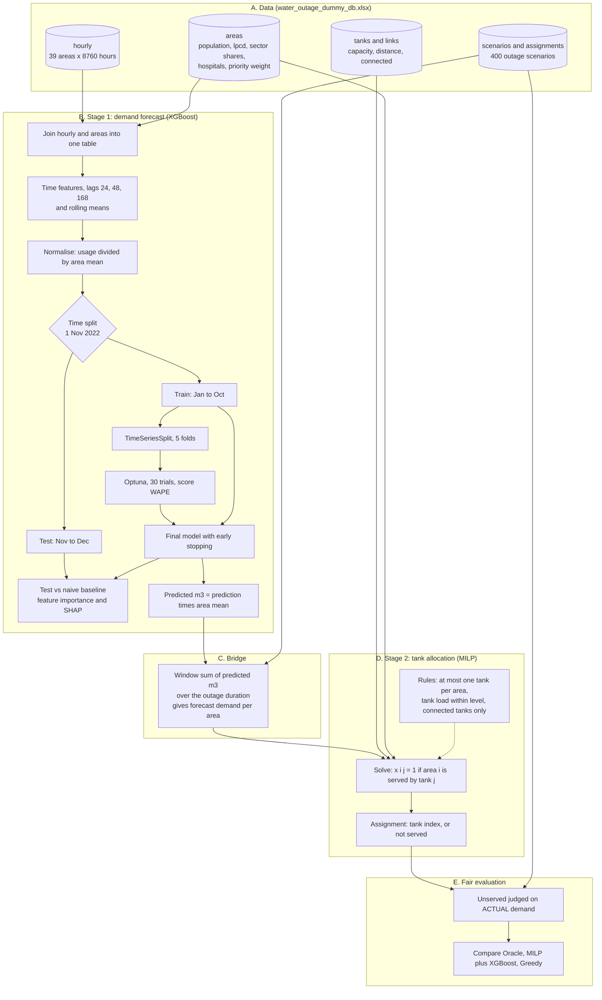
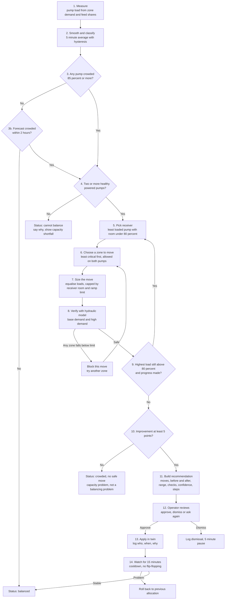

# Product Requirements Document: Water Autonomy Twin

| | |
|---|---|
| **Product** | Water Autonomy Twin: water service continuity during outages, from district scale to a single building |
| **Version** | 0.2 (adds the XGBoost + MILP outage backbone to the v0.1 building twin) |
| **Date** | 23 November 2026 |
| **Context** | Water AI Hackathon 2026 (Wilo Türkiye, İmece). Interim submission (idea canvas, pitch deck, Design Thinking canvas) due **Tuesday 24 Nov 2026, 23:59 Istanbul**; finalists announced 30 Nov; hackathon 5 Dec, Istanbul, pitch in Turkish. |
| **Sources** | *Kerangka Acuan* (reference framework), *Proje Fikri Kanvası* (idea canvas), hackathon meeting notes 1 and 2, export of the forecast and allocation work from the earlier chat ("backbone export") |
| **Status of the code** | **In this repository:** the building-level twin, pump load balancer, usage calculation and dashboard run end to end (`./run.sh`); 34 automated tests pass. **Not in this repository:** the XGBoost forecaster and MILP allocator. They exist as a Colab notebook and a synthetic database, and their results below are as reported from that run; they have not been re-run or integrated here. |

---

## 1. Summary

Water Autonomy Twin answers one family of questions for facility teams and water operators:

> *If service is disrupted now, who loses water first, how much water will each affected area need, which supply point should serve which area, and what should the operator consider doing?*

It has **two levels that share one pattern** (forecast the demand, allocate limited supply under hard constraints, verify, explain, and let a person decide):

| Level | Supply points | Demand units | Disturbance | Allocation engine | AI |
|---|---|---|---|---|---|
| **A. District outage planner** (the AI backbone, section 7) | Storage tanks | Areas (the demo uses Istanbul's 39 ilçe) | Water outage of 4 to 24 hours over several areas | **MILP** assignment of areas to tanks | **XGBoost** demand forecast |
| **B. Building twin** (sections 8 to 10) | Booster pumps and the building tank | Service zones | Pump failure, power loss, city supply cut, crowded pump | **Load balancer** re-allocating zone feeds across pumps, checked by a hydraulic model | Baseline today; ML forecaster and learned generator in Phase 2 |

Why two AI methods, not one: *how much water is needed* is a guess about repeating patterns, so a learned model fits. *Which tank serves which area* is a choice under hard rules (capacity, connectivity), so an optimizer fits; a pure guess could break physical limits. Catering analogy: stage 1 estimates the portion per table from earlier events, stage 2 divides the tables among kitchens so none runs out of ingredients.

**The product never controls pumps or valves.** It produces simulations and recommendations that a person reviews. "Apply" changes only the simulated allocation inside the twin.

**Everything in the demo is synthetic.** Only Istanbul's 2022 annual consumption and population per district are real inputs (section 7.3). No accuracy in a real network is claimed.

## 2. Problem and opportunity

When water, power or a pump is lost, operators see alarms and tank levels, but that does not tell them *when each zone will lose service*, *how much water each affected area needs*, or *which tank should serve which area*. The outcome depends on effective tank capacity, connectivity, elevation, pressure limits, demand, standby pumps and backup power (Kerangka Acuan, section 1). In daily operation one pump can also run near or above its rating while its neighbour idles, which wastes pump life and removes the headroom that makes a failure survivable.

**Honest positioning.** Wilo already monitors pump data and has AI work on demand anticipation, pressure control, simulation and optimization (Kerangka Acuan, section 2; the InstaDeep partnership). Booster controllers already stage and alternate pumps (meeting 1). So the claims are deliberately narrow:

- *"This specific feature, remaining service time and tank allocation per area or zone under combined disturbances, was not found in public Wilo information."* This is a gap in public sources, not proof that Wilo has nothing similar.
- The outage planner differs from simple dispatch rules because it forecasts demand for the outage window and then assigns whole areas to tanks with an optimizer, and it is evaluated against the actual demand, not the forecast.
- The load balancer differs from pump staging because it re-allocates **zone feeds across pumps**, respects zone **priority**, and **verifies pressure** in every zone before recommending anything.

## 3. Goals and non-goals

### Goals

| # | Goal | How we know |
|---|---|---|
| G1 | Show time until each building zone drops below its pressure or flow threshold, with a range | Scenario lab returns best, base and worst per zone |
| G2 | Detect a crowded pump while another has room, and recommend a safe re-allocation | Balancer plan lowers the highest pump load and keeps every zone in service |
| G3 | Forecast the water each area needs during an outage window, and beat a simple baseline at every outage duration | WAPE of the forecast below the "same hour last week" baseline for 4, 6, 8, 12 and 24 h |
| G4 | Assign affected areas to tanks so that as little demand as possible goes unserved | Unserved share of total demand, judged on **actual** demand, close to the Oracle and below Greedy |
| G5 | Calculate usage, profile and forecast from a customer database | Usage tab works from SQLite, a mapped external DB, or CSV |
| G6 | Make every assumption and limit visible | Assumptions panel, SIMULATED/MEASURED label, operator-review banner |
| G7 | Run without an ML model today and accept one tomorrow | Forecast and candidate generation sit behind swappable interfaces with a labelled baseline fallback |

### Non-goals (this version)

- No automatic control of pumps or valves, and no connection to a control system (Kerangka Acuan, "Batas prototipe").
- No claim that a building or district is "safe" or "emergency-ready", and no real-world accuracy claim (for example, never "97% accuracy").
- No pipe network, pressure or hydraulic loss in the district allocator: it assigns whole areas to tanks. Network-level accuracy is the EPANET step in Phase 2.
- No splitting of one area across several tanks in the district allocator (a possible extension, section 7.10).
- No validation on a real building or on İSKİ operational data.

## 4. Users

| User | Job to be done | Primary screens |
|---|---|---|
| **Facility manager / building operations** (primary) | Know which zone fails first, how long to prepare, and keep pumps healthy | Dashboard, Load balancer, Scenario lab |
| **Emergency response team** | Prioritise critical zones (clinic, emergency) and decide which areas a tank serves during an outage | Scenario lab, Outage planner |
| **Water utility operator** (district level) | Plan tanker or tank supply across areas for a multi-hour outage | Outage planner |
| **Engineer / mentor** | Check assumptions, thresholds, and the models against data | Usage and data, assumptions, configuration files, notebook |
| **Hackathon judges** | See problem-need-solution fit, meaningful AI use, feasibility and impact | Whole product, PRD, demo script |

## 5. Scope (MVP)

### Level B: building twin (built)

One example building with **one tank, two booster pumps and three service zones**, as the Kerangka Acuan recommends. The topology is data-driven (`backend/data/building.json`), so more pumps and zones need no code change.

| Zone | Description | Priority | Elevation | Min pressure |
|---|---|---|---|---|
| Z1 | Ground to L2, clinic and emergency | 1 (critical) | 6 m | 1.5 bar |
| Z2 | L3 to L6, classrooms and labs | 2 | 15 m | 1.5 bar |
| Z3 | L7 to L10, dormitory and offices | 3 | 28 m | 1.3 bar |

Default allocation: Pump A feeds Z1 and Z2, Pump B feeds Z3. This is intentionally lopsided, so the daytime peak crowds Pump A while Pump B idles, which is the case the load balancer exists for.

### Level A: district outage planner (validated offline, integration planned)

**39 areas** (Istanbul ilçe, A01 to A39) and **12 fictional tanks** (T01 to T12) with capacity, minimum fill, pump station rate and distance-based connectivity. 400 simulated outage scenarios (352 train, 48 test). Full data description in section 7.3.

**How the levels relate.** The same four ideas appear twice (forecast, allocate under constraints, verify, operator decides), at different scale:

| Concept | Level A (district) | Level B (building) |
|---|---|---|
| Demand unit | Area (`area_id`, priority weight from hospitals and schools) | Zone (priority 1 to 3) |
| Supply unit | Tank (`level` in m³, connectivity) | Pump (rated flow, allowed pumps per zone) |
| What is decided | Whole area to one tank, or unserved | Fraction of a zone's feed per pump |
| Constraint check | Tank load not above level; only connected tanks | Receiver cap, hydraulic pressure check at base and high demand |
| Fairness check | Unserved demand judged on actual demand | Plan verified at high demand with a pressure margin |
| Human step | Operator reviews the proposed assignment | Operator approves, dismisses or rolls back |

## 6. Feature map



## 7. AI backbone: district outage planner (XGBoost forecast + MILP allocation)

> **Status.** Designed, run and measured in a Colab notebook (`xgboost_demand_forecast_colab.ipynb`) on a synthetic database (`water_outage_dummy_db.xlsx`). Numbers in 7.8 are as reported from that run. The code is **not yet in this repository**; section 12 lists what integration means. The notebook and database were not available when this PRD was updated, so nothing here was re-run.

### 7.1 What it does

For a multi-hour outage affecting several areas, it answers two questions in order:

1. **How much water does each affected area need during the outage window?** (XGBoost, stage 1)
2. **Which tank serves which area?** (MILP, stage 2, using stage 1's numbers)

The result is a proposed assignment per area (a tank, or "not served"), the expected unserved share of demand, and a comparison with simpler policies. The operator reviews it; nothing is executed.

### 7.2 Flow



### 7.3 Data

**Calibration (the only real inputs).** The database is calibrated to the user's `Water.xlsx` (annual consumption per ilçe 2015 to 2022, m³, 39 ilçe) and a population list per ilçe (nufusu.com, unofficial). Findings that shaped the design:

- Population explains *which* districts are large (combined r about 0.93; Istanbul total per year r about 0.96).
- Per-capita use rose from **115.8 to 151.2 L per person per day (2015 to 2022)**: water +42% against population +8.5%. The causes (meter coverage, tariffs, the 2020 pandemic, non-residential use) are a hypothesis and untested.
- Data is yearly only. Open daily or hourly consumption per area is almost unavailable; İZSU's daily production web service is the closest.
- District-name fixes used: GOP to GAZİOSMANPAŞA, B.ÇEKMECE to BÜYÜKÇEKMECE, K.ÇEKMECE to KÜÇÜKÇEKMECE, SALTANGAZİ to SULTANGAZİ.

**Tables (7 sheets).**

| Sheet | Rows | Content |
|---|---|---|
| README | | Data dictionary and assumptions |
| `areas` | 39 | `area_id`, `district`, approximate lat and lon, `population_2022`, `households_est`, `annual_consumption_m3_2022`, `lpcd_2022`, `share_residential/commercial/industrial`, `hospitals`, `schools`, `priority_weight`, `priority_class` |
| `tanks` | 12 | `tank_id`, fictional lat and lon, `capacity_m3`, `min_fill_pct`, `pump_station_m3h` |
| `area_tank_links` | 468 | `area_id`, `tank_id`, `distance_km` (haversine), `connected` (0 or 1) |
| `hourly_usage_2022` | 341,640 | `timestamp`, `area_id`, `hour`, `day_of_week`, `month`, `is_holiday`, `temperature_c`, `usage_m3` |
| `outage_scenarios` | 400 | `scenario_id`, `split`, `outage_start`, `duration_h`, `n_areas_affected`, `total_demand_m3`, `total_tank_available_m3`, `all_served`, `unserved_demand_m3`, `greedy_unserved_m3`, `tank_levels_m3` (JSON, T01 to T12), `temperature_c` |
| `scenario_assignments` | 9,163 | `scenario_id`, `area_id`, `priority_weight`, `demand_m3`, `optimal_tank_id`, `optimal_distance_km`, `greedy_tank_id` (`NONE` = not served) |

**Generation rules (seed 2022), so the data can be rebuilt.**

- *Calibration:* per area, the 8,760 hourly values sum to `annual_consumption_m3_2022` (difference about 1e-8). Istanbul average is about 151 L per person per day.
- *Sector shares:* default 0.78 / 0.17 / 0.05 (residential, commercial, industrial); industrial districts (for example Tuzla, Esenyurt, Başakşehir, Arnavutköy, Pendik) 0.60 / 0.15 / 0.25; commercial districts (for example Şişli, Beşiktaş, Fatih, Kadıköy) 0.55 / 0.40 / 0.05; small noise added.
- *Hourly profile:* residential peaks about 07:30 and 20:30 plus a midday shoulder; commercial about 11:00 and 15:00; industrial about 10:00 and 14:00. Weekends and holidays: residential ×1.10 and shifted +1.5 h, commercial ×0.70, industrial ×0.55.
- *Temperature:* monthly means (6, 6.5, 8, 12, 17, 22, 25, 25.5, 21.5, 17, 12, 8 °C) plus a daily cycle of ±4 °C plus noise. Consumption multiplier `1 + 0.014 × max(T − 18, 0)`.
- *Noise:* AR(1), φ = 0.6, σ = 0.05, then the series is rescaled so the annual sum is exact.
- *Priority:* `hospitals = max(1, round(pop/90000 + N(0, 0.8)))`, `schools = max(2, round(pop/6000 + N(0, 5)))`, `priority_weight = 1 + 0.35 × hospitals + 0.02 × schools`; class A if hospitals ≥ 7, B if ≥ 4, else C.
- *Tanks:* 12 fictional locations; `capacity = max(25,000, daily demand of nearest areas × U(0.9, 1.5))` rounded to 100; `min_fill_pct ~ U(0.65, 0.95)`; pump station = capacity / 8.
- *Connectivity:* connected if distance ≤ 14 km, and every area is connected to at least its 2 nearest tanks.
- *Scenarios (400):* random start hour; duration from [4, 6, 8, 12, 24] h with probabilities [0.20, 0.25, 0.25, 0.20, 0.10]; share of areas affected from [0.2, 0.4, 0.6, 0.8, 1.0] × 39 (at least 3 areas); initial tank level = capacity × U(0.25, 0.70). `split = train` if the outage starts before 1 Nov 2022, else `test`.
- *Labels:* Optimal = MILP with actual demand. Greedy = largest demand first, to the nearest connected tank that still fits.
- *Scenario statistics:* about 91.75% of scenarios can serve every area; about 8% cannot (stock is short), so some areas are `NONE`; MILP beats Greedy in about 12.75% of scenarios.

### 7.4 Stage 1: demand forecast (XGBoost)

**Variables.**

| Variable | Meaning |
|---|---|
| `df` | Main table: one row per area per hour after joins and features |
| `STATIC` | Area attributes: `population_2022`, `households_est`, `lpcd_2022`, three sector shares, `hospitals`, `schools`, `priority_weight` |
| `LAGS` | `lag_24`, `lag_48`, `lag_168`, `roll_mean_24`, `roll_mean_168`, `roll_std_24` |
| `FEATURES` | 27 features: `area_id` (category), `hour`, `day_of_week`, `month`, `is_holiday`, `is_weekend`, sin and cos of hour and weekday, `temperature_c`, `temp_above18`, `STATIC`, and the normalised (`_n`) versions of `LAGS` |
| `area_mean` | Mean `usage_m3` per area, **computed on train only** |
| `y` | Target = `usage_m3 / area_mean`; lags are divided by `area_mean` too |
| `SPLIT_DATE` | 2022-11-01 (train Jan to Oct, test Nov to Dec) |
| `pred_m3` | `model.predict × area_mean`, in m³ |

**Design rules (do not break when modifying).**

1. **Every lag is at least 24 hours.** An outage lasts at most 24 hours, so every feature is known when it starts. Rolling means are computed from the series shifted by 24 h (leak-free). `lag_1` is only safe for recursive forecasting.
2. **Split by time, never random.** Validation uses `TimeSeriesSplit` over **unique hours** so all areas at the same hour sit in the same fold.
3. **Per-area normalisation** so one global model can learn from 39 areas of different scale; `area_mean` comes from train only.
4. The first week of rows is dropped (lags incomplete).
5. In the real world, `temperature_c` must be a weather **forecast**, not the measured temperature.

**Algorithm (notebook steps 0 to 14).**

| # | Step | What happens |
|---|---|---|
| 0 | Setup | Install `optuna`, `shap`, `xgboost`; imports |
| 1 | Load | Upload or mount Drive; read 6 sheets (about 40 s) |
| 2 | Join | Merge `hourly` with `areas` (STATIC); `area_id` as category; sort by area then time |
| 3 | Time features | `is_weekend`, sin and cos of hour and weekday, `temp_above18` |
| 4 | Lag features | `groupby("area_id").shift(24/48/168)`; rolling means from the 24 h shifted series; drop incomplete rows |
| 5 | Target | `area_mean` from train; `y` and `*_n` |
| 6 | Split | Train before 2022-11-01, test after |
| 7 | Validation | `TimeSeriesSplit(5)` over unique hours; metric `WAPE = sum(abs(actual − predicted)) / sum(abs(actual))` |
| 8 | Tuning | Optuna (TPE, seed 42), 30 trials. Space: `learning_rate` 0.03 to 0.2 (log), `max_depth` 4 to 10, `min_child_weight` 1 to 20 (log), `subsample` 0.6 to 1, `colsample_bytree` 0.5 to 1, `reg_lambda` 1e-3 to 10 (log). `n_estimators` 2000 with early stopping 50. Score: WAPE in m³, mean of the last 3 folds |
| 9 | Train | `XGBRegressor(**best_params, n_estimators=max(2*best_n, 300), tree_method="hist", enable_categorical=True, early_stopping_rounds=50)`; last 10% of train hours as eval set |
| 10 | Evaluate | MAE and WAPE vs the naive baseline (`lag_168`); per area, per hour, and aggregated per outage duration |
| 11 | Interpret | `get_score("gain")` and SHAP `TreeExplainer` (3,000-row sample) |
| 12 | Scenario forecast | `window_sum` per (area, `outage_start`, `duration_h`) gives `demand_forecast_m3`; check actual demand matches the sheet |
| 13 | Test stage 2 | `solve_milp`, `real_unserved`, `evaluate` (7.6, 7.7) |
| 14 | Save | `xgb_demand.json`, `xgb_demand_meta.json`, `scenario_demand_forecast.csv`, `test_predictions.csv` |

### 7.5 Bridge: from hourly forecast to one number per area

Stage 2 does not need hourly values. It needs one number per area per outage:

```
demand_forecast_m3(area, start, dur) = sum( pred_m3[area, start .. start + dur - 1 hour] )
```

Implemented by `window_sum(series, area, start, dur)` on a series indexed by `(area_id, timestamp)`.

### 7.6 Stage 2: tank allocation (MILP)

Solved with `scipy.optimize.milp` (HiGHS), `time_limit = 30` seconds.

| Variable | Meaning |
|---|---|
| `area_ids` | Areas that have no water in this scenario |
| `demand` | Water needed per area (forecast or actual), m³ |
| `level` | Water in each tank (order `TANK_IDS`), m³ |
| `dist`, `conn` | Distance (km) and connectivity (0 or 1), area by tank |
| `prio` | `priority_weight` per area |
| `x[i,j]` | Binary: 1 if area *i* is served by tank *j* |
| `assign` | Result: tank index per area, `-1` = not served |

```
Variables:    x[i,j] in {0,1}, upper bound conn[i,j]   (an area may only use a connected tank)
Constraint 1: sum_j x[i,j] <= 1                         (each area goes to at most one tank; areas are not split)
Constraint 2: sum_i demand[i] * x[i,j] <= level[j]      (a tank never gives more than it holds)
Minimise:     sum_ij ( demand[i]*dist[i,j]/100 - 1000*prio[i]*demand[i] ) * x[i,j] / 1000
```

The second term in the objective is a reward for serving, weighted by priority; it dominates. Distance only breaks ties.

### 7.7 Fair evaluation

The assignment is built from the **forecast** demand but scored with the **actual** demand:

```
unserved = sum( actual[area not served] )
         + sum_j max( 0, sum( actual[areas assigned to tank j] ) - level[j] )
```

Three policies are compared on the 48 test scenarios:

| Policy | Meaning |
|---|---|
| **Oracle** | MILP with actual demand. The ideal upper bound; not usable in real life |
| **MILP + XGBoost** | The policy the product uses |
| **Greedy** | Baseline: largest demand first to the nearest connected tank that fits. It is computed with *actual* demand in the sheet, so it is favoured and the comparison is conservative |

### 7.8 Results so far (synthetic data, as reported from the Colab run)

| Metric | Result |
|---|---|
| Optuna best cross-validated WAPE (30 trials, trial #27) | **5.63%** (3 trials gave 5.73%, so more trials add little) |
| Best parameters | `learning_rate` 0.0347, `max_depth` 6, `min_child_weight` 1.14, `subsample` 0.896, `colsample_bytree` 0.507, `reg_lambda` 0.619, mean `n_estimators` 1174 |
| Optuna time in Colab | about 1 hour for 30 trials (the initial estimate was 12 to 15 minutes) |
| Hourly WAPE on test | about 5% XGBoost vs about 7% naive baseline |
| Hourly WAPE by time of day | about 5.2 to 5.4% from 04:00 to 22:00; about 6.5 to 7% from 00:00 to 03:00 (small usage, so noise weighs more; hypothesis) |

WAPE of total demand by outage duration:

| Duration | XGBoost | Naive (`lag_168`) |
|---|---|---|
| 4 h | 4.20% | 5.50% |
| 6 h | 3.75% | 4.91% |
| 8 h | 3.39% | 4.43% |
| 12 h | 2.99% | 3.85% |
| 24 h | 2.31% | 2.86% |

Scenario-level demand WAPE per area: train 2.76% (345 scenarios, in-sample), **test 3.15%** (48 scenarios).

Unserved demand as a share of total demand on the 48 test scenarios:

| Policy | Buffer 0% | Buffer 5% |
|---|---|---|
| Oracle | **3.68%** | 3.68% |
| **MILP + XGBoost** | **3.80%** | 4.28% (worse) |
| Greedy | **4.44%** | 4.44% |

How to read it:

- XGBoost beats the simple baseline at every outage length. Totals get more accurate for longer outages because hourly errors cancel out.
- MILP + XGBoost closes about **84%** of the gap between Greedy and Oracle, and leaves about **14% less** unserved demand than Greedy.
- Oracle's 3.68% is not an error: in some scenarios there is simply not enough water in the tanks.
- Feature importance (gain): `lag_168_n` far above `hour`, then `lag_24_n`, `lag_48_n`; temperature, month and population are near zero. A likely reason is that the test months (Nov and Dec) are cold, so `temp_above18` is almost always 0, and the lags already carry the temperature effect (hypothesis, untested).
- SHAP: high lags push the guess up; early-morning hours push it down; evening hours push it up. SHAP shows what the model uses, not a cause in the real world.
- The model slightly underestimates the highest peaks (seen for A15 Esenler in the first test week).

### 7.9 Decisions already made

1. Two stages (XGBoost, then MILP), not one end-to-end model.
2. Minimum lag 24 h; no `lag_1`.
3. Time split at 1 Nov 2022; no shuffling.
4. Target normalised per area with a train-only `area_mean`.
5. Optuna with WAPE as the metric; 30 trials are enough.
6. **Final policy: MILP + XGBoost with a 0% buffer.** Oracle is the upper-bound comparison, Greedy the baseline. A 5% safety buffer was tested and **rejected**: because an area cannot be split, inflated demand makes some areas look "too big" and leaves them unserved.
7. The system is positioned as proof that the pipeline runs end to end, not as a field accuracy claim.

### 7.10 What may not be claimed

- **All data is synthetic.** Tanks, coordinates, distances, connectivity, hourly profiles, temperature, holidays and scenarios are simulation assumptions, not İSKİ operational data. Only 2022 annual consumption and district population are real.
- Honest sentence for the pitch: *"Our pipeline runs end to end and, on simulated data calibrated to 2022 consumption, the model beats the simple method at every outage duration."* Never "97% accuracy".
- One year of data: seasons and holidays cannot be validated across years; the test months do not include summer.
- 48 test scenarios: 3.80% vs 3.68% is a small gap; do not say "exactly the same".
- Whole-area assignment only: no pipes, pressure or hydraulic loss. Possible extension: allow an area to be split across tanks.
- Scenario demand on the train split is predicted in-sample; only test numbers may be quoted as results.
- The Greedy comparison is conservative (Greedy used actual demand).
- Further robustness work worth doing: several scenario seeds with confidence ranges, tighter tank stock, split-area allocation.

## 8. The AI load balancer (building level)

### 8.1 What it does

It watches how hard each pump is working. When one pump is **crowded** and another is **not overly crowded**, it proposes moving part of a zone's water feed from the crowded pump to the one with room, proves the move is hydraulically safe, explains it, and waits for the operator.

It runs in two modes:

- **Reactive:** a pump is crowded right now.
- **Predictive:** a pump is *forecast* to become crowded in the next 2 hours (for example, before the weekday midday peak). The operator can act early.

### 8.2 Definitions

| Term | Definition |
|---|---|
| **Pump load %** | Requested flow through the pump divided by its rated flow. It can exceed 100% because it measures what the zones are asking for, not what the pump could deliver. |
| **Smoothed load** | Exponential average of load over about 5 simulated minutes (α = 0.2), so a brief spike does not trigger advice. |
| **Crowded** | Smoothed load ≥ 85%. Stays crowded until it falls below 78% (hysteresis, so the flag does not flicker). |
| **Overloaded** | Load ≥ 100% of rated flow. |
| **Light load** | Load < 65%. |
| **Receiver** | A healthy, powered pump the zone is allowed to use, and which stays at or below 80% after taking more flow. |
| **Feed share** | The fraction of a zone's flow supplied by each pump. Re-allocation changes feed shares. |

All thresholds live in `building.json` under `balancer` and are set by the building's engineers, not by the system.

### 8.3 Steps



**Plain-language walk-through**

1. **Measure.** For each pump, add up (zone demand × that pump's feed share) and divide by the pump's rated flow.
2. **Smooth and classify.** Use a 5-minute average and the hysteresis thresholds in 8.2.
3. **Detect.** If a pump is crowded, continue. If none is, look at the demand forecast for the next 2 hours; if a pump would get crowded, continue in predictive mode.
4. **Check there is something to balance.** With only one healthy, powered pump the balancer says so and explains the shortfall (for example, "demand 44 m³/h exceeds capacity 30 m³/h; lowest-priority zones will be curtailed"). That is a capacity problem, not a balancing problem.
5. **Pick a receiver.** The least-loaded eligible pump with room under the receiver cap.
6. **Pick a zone.** Among zones allowed on both pumps and currently fed by the crowded pump, move the **least critical** one first.
7. **Size the move.** Move enough flow to equalise the two pumps' load percentages, limited by (a) the receiver's room, (b) a ramp limit of 60% of the zone's flow, and (c) the zone's flow on the crowded pump.
8. **Verify.** Re-run the hydraulic step with the new allocation at base demand **and** at high demand (+ the zone's typical forecast uncertainty). Reject the move if any zone that was fine would fall below its minimum pressure plus a 0.1 bar margin.
9. **Repeat** until the highest load is at or below 80% or no further safe move exists.
10. **Require a real improvement** (at least 5 percentage points). Otherwise report why nothing was proposed.
11. **Explain.** The recommendation includes the moves, before and after load per pump, the range at ±demand, five safety checks, a confidence level, and a numbered checklist for the operator.
12. **Operator decides.** Approve, dismiss, or re-evaluate. Stale recommendations are rejected (HTTP 409) so nobody approves something that no longer matches the plant.
13. **Apply (in the twin only).** Changes the simulated feed shares and writes an audit entry.
14. **Settle.** A 15-minute cooldown prevents back-and-forth. **Roll back** restores the previous allocation in one click.

### 8.4 Worked example (from the running prototype)

Weekday midday, all-zone demand at 150% (a busy day), starting allocation Pump A to Z1 + Z2, Pump B to Z3.

| | Pump A | Pump B | Z2 pressure | Demand not served |
|---|---|---|---|---|
| Before | **128%**, overloaded | 23%, light load | 1.8 bar (limit 1.5) | about 1 to 4 m³/h short (varies with the live demand noise) |
| Recommendation | Move **15.7 m³/h (about 59% of Z2's flow)** from Pump A to Pump B via crossover valve XV-2 | | | |
| After (predicted) | **76%** | **76%** | 2.5 bar | 0 |

Z2 (priority 2) is moved rather than the clinic zone Z1 (priority 1). All five safety checks pass; confidence is "high". The dashboard draws the proposed flow as a dashed pipe from Pump B to Z2 with the label "proposed +15.7 m³/h", and the load bars show an outline for the after state.

### 8.5 Constraints the optimizer respects

- **Allowed pumps per zone** (crossover piping and valves): a zone is only moved to a pump listed in `allowed_pumps`.
- **Priority:** least critical zone moves first; the critical zone is moved only if nothing else works and checks pass.
- **Pump limits:** the receiver never goes above the receiver cap (80%); no pump exceeds its max flow.
- **Hydraulic safety:** every zone that is in service stays in service, with a pressure margin, at base and high demand.
- **Ramp limit:** at most 60% of a zone's flow moves in one recommendation, applied in stages of ≤10% every 2 minutes (shown in the operator steps).
- **Stability:** hysteresis, smoothing, cooldown and a stable recommendation ID while the operator is reading it.

### 8.6 Outputs

Each recommendation (see `GET /api/loadbalancer`) contains: plan ID, basis (current or forecast peak), trigger rule in words, per-pump load before and after, after-load range, list of moves (zone, from, to, m³/h, share before and after, crossover valve), predicted zone pressures, safety checks, confidence, operator steps, rollback condition, `requires_operator_approval: true` and `controls_real_pumps: false`.

### 8.7 Status values shown to the operator

| Status | Meaning |
|---|---|
| Balanced | Pumps are sharing the load; nothing to do |
| Recommendation ready | A pump is crowded and a safe re-allocation exists |
| Watch: peak ahead | Forecast says a pump will be crowded within 2 hours; a pre-emptive plan is offered |
| Settling | An approved change was applied; watching before suggesting anything else |
| Cannot balance | Fewer than two healthy, powered pumps; the reason and shortfall are shown |
| Crowded, no safe move | A move exists on paper but fails the hydraulic check, or no zone/pump can take the load |

### 8.8 Metrics for this feature

| Metric | Target |
|---|---|
| Highest pump load after approval | ≤ 80% when a safe plan exists |
| Pump load spread (highest minus lowest) | Reduced by ≥ 50% on accepted plans |
| Zones in service after applying | 100% of zones that were in service before |
| Unserved demand during a crowded period | Reduced to 0 where capacity exists |
| False alarms (recommendation dismissed as unnecessary) | Tracked from the audit log; target < 20% |
| Time from crowded flag to recommendation | ≤ 1 simulated minute |

### 8.9 Where AI plugs in (Phase 2)

Today the balancer is a **rule-based water-filling optimizer** (no ML) wrapped in the pipeline an ML component would need. Because steps 8 to 14 (verify, explain, approve, log, roll back) do not depend on how a candidate was produced, an AI model can be introduced without removing the safety layer. With the backbone in section 7 the table changes as follows:

| Slot | Phase 1 (in this repository) | Phase 2 |
|---|---|---|
| Demand input | Seasonal hour-of-week mean with ± band (`DemandProvider`) | **XGBoost forecaster from 7.4** retrained on the building's zone data and benchmarked against the baseline (same lag-of-24-h-or-more rule, same per-area scaling) |
| Candidate generator | Greedy water-filling with priority ordering (`balancer.plan`) | An optimizer in the style of 7.6 (a MILP or LP over feed shares with the same constraints) or a learned policy (for example reinforcement learning in the twin) proposing candidate shares. *Proposal; not tested.* |
| Verifier | Twin-lite hydraulic step | EPANET-backed check |
| Anomaly detection | Not included | Flag sensor drift or abnormal pump behaviour before it feeds the model |

Meeting 2 states that AI must be the *main technology* of the solution and that "meaningful use of AI" carries 20% of the score. The backbone in section 7 is the strongest answer to that today; the building twin supplies the verified, operator-reviewed workflow around it.

## 9. Hydraulic model ("twin-lite", building level)

All physics is in one function (`hydraulics.step`). The live twin and the scenario lab both call it, so they cannot disagree.

| Item | Model |
|---|---|
| Tank volume | `V(t+Δt) = V(t) + [Q_in(t) − Q_out(t)] · Δt` (from the Kerangka Acuan), clipped to `[0, capacity]`; a dead volume below which pumps lose suction |
| Pump head | `H(Q) = H0 − a·Q²`, with `a` fitted so the curve passes through the rated duty point |
| Zone pressure | `P = (H_pump − elevation − k·Q_zone²) / 10.197` bar, capped at the zone's pressure set-point (PRV or booster control) |
| Overload | A pump cannot exceed max flow; zones are curtailed lowest priority first |
| Pressure vessel buffer | Each zone has a small buffer that bridges short gaps; pressure from the buffer decays linearly with fill |
| Power | Pumps run on grid, or on the generator if covered and fuel remains |
| Auto-failover | If a zone's pump is down, its share moves to the other allowed pumps (the building's own duty/standby behaviour) |
| Service threshold | A zone is *in service* when pressure ≥ its minimum **and** served flow ≥ its minimum flow ratio. Breach is declared after 2 consecutive minutes below. |

**Limits (shown in the UI).** Friction is a single coefficient per zone, not a pipe network; the vessel decay is linear; thresholds and capacities must come from the building's engineers (the system never sets safety limits itself). Replace this module with EPANET for network-level accuracy and calibrate against real pressure and level readings.

## 10. Usage calculation from a database you provide

You will provide a database. The twin reads it through a **mapping file**, so a different table or column naming needs no code change. This covers the building twin's `usage_readings`; the district outage database has its own schema (section 7.3) and loader (F7.1).

### 10.1 What the twin needs

| Required | Optional |
|---|---|
| Timestamp, zone identifier, and **one** of: average flow (m³/h), volume per interval (m³), or a cumulative meter reading (m³) | Occupancy (people), source label (`MEASURED` or `SIMULATED`), pump readings (status, flow, pressure, power), tank readings (level, volume) |

Recommended: at least 4 weeks of history (8 weeks gives better weekday patterns; a year allows the XGBoost model of section 7), a reading every 5 to 15 minutes, timestamps in UTC.

### 10.2 Three ways to connect

1. **CSV import** (dashboard tab *Usage and data*, or `python backend/scripts/import_csv.py file.csv`). Columns: `ts, zone_id, flow_m3h` *or* `volume_m3`, optional `occupancy, source`. A template is at `GET /api/data/template.csv`.
2. **Point the twin at your SQLite file** in `backend/data/db_mapping.json`: set `db_path`, `table`, `ts_col`, `zone_col`, `value_col`, `value_kind` (`flow_m3h`, `volume_m3` or `cumulative_m3`), `ts_format` (`iso`, `epoch_s`, `epoch_ms`), and `zone_aliases` to translate your zone names. The file is opened **read-only**.
3. **Another database engine** (PostgreSQL, SQL Server, etc.): export to CSV now; a repository class for the engine is a small addition behind the same interface (`UsageRepository.fetch_flows`).

Safety: table and column names from the mapping are validated as plain identifiers before they reach SQL; values are always bound parameters.

### 10.3 Calculations

| Quantity | Formula |
|---|---|
| Flow from interval volume | `q = v / Δt` |
| Flow from a cumulative meter | `q = (c_t − c_{t−1}) / Δt`; negative differences (meter reset) are skipped |
| Total volume | `V = Σ q_i · Δt_i` |
| Average flow | `V / T` |
| Peak | maximum summed flow and the local time it occurred |
| Hourly profile | mean flow by local hour of day; also by weekday |
| Per-person use | `litres per person per day = (m³ per day × 1000) / average occupancy` |
| Forecast mean (baseline) | mean of the same **hour-of-week** over the last 8 weeks, linearly interpolated between hour centres |
| Forecast band | mean ± σ of those samples |
| Fallbacks (flagged in the UI) | < 3 samples for an hour-of-week: use hour-of-day mean; no data for a zone: use the configured synthetic shape (`synthetic-config`) |
| Scenario uncertainty | demand × (1 − cv), × 1, × (1 + cv), where cv is the median σ/μ per zone, clamped to 8% to 30% |
| Forecast accuracy | Back-test on the last 7 days with the profile built only from earlier data. Reports MAE, MAPE (hours with flow > 0.5 m³/h), the same for "same hour yesterday", and the share of hours within ±1σ |
| Outage window demand | `sum of hourly forecast over the outage duration` (section 7.5) |
| WAPE (used by the XGBoost work) | `sum(abs(actual − predicted)) / sum(abs(actual))` |

On the building demo data the baseline back-test gives about 3 to 4% error per zone against 6 to 35% for "same hour yesterday". This, like the numbers in 7.8, demonstrates the method on **simulated** data only; it says nothing about a real building or network.

### 10.4 Data honesty

Demo data is generated and every row is labelled `SIMULATED`. The dashboard shows a visible *Simulated data* badge until measured rows replace it. Per the Kerangka Acuan, synthetic results are never presented as validation on a real building or network.

## 11. Functional requirements

Priority: **M** must, **S** should, **C** could. Status: **Built** = running in this repository; **Offline** = designed and run in the Colab notebook on synthetic data, not in this repository; **Planned** = not yet.

| ID | Requirement | Pri | Status |
|---|---|---|---|
| F1.1 | Read usage from a configurable database table through `db_mapping.json` (flow, volume or cumulative; ISO or epoch timestamps; zone aliases) | M | Built |
| F1.2 | Import usage CSV with validation, warnings and replace-simulated option | M | Built |
| F1.3 | Label every data set `SIMULATED`, `MEASURED` or `MIXED` and show it | M | Built |
| F1.4 | Usage summary: total, average, peak with time, hourly and weekday profile, litres per person per day | M | Built |
| F1.5 | Baseline demand forecast with uncertainty band and back-test | M | Built |
| F1.6 | ML demand forecaster behind the same `DemandProvider` interface, with the baseline as a labelled fallback when the model file is missing | S | Offline (XGBoost, section 7.4); app integration Planned |
| F2.1 | Tank mass balance, pump curves, zone pressure, overload curtailment by priority | M | Built |
| F2.2 | Live simulation clock with speed control and time-of-day jumps | M | Built |
| F2.3 | Disturbance controls: fail a pump, grid loss, generator, city supply, global and per-zone demand | M | Built |
| F3.1 | Scenarios: normal, pump failure, power outage, city supply cut | M | Built |
| F3.2 | Time to threshold per zone with best, base and worst case | M | Built |
| F3.3 | Preparation time, lowest pressure, demand met, priority demand met | M | Built |
| F3.4 | Compare results with and without balancer recommendations followed | S | Built |
| F4.1 | Monitor smoothed pump load with hysteresis | M | Built |
| F4.2 | Detect crowded pump now and in the next 2 hours | M | Built |
| F4.3 | Propose a re-allocation to a receiver pump honouring allowed pumps, priority, caps and ramp limit | M | Built |
| F4.4 | Verify every plan with the hydraulic model at base and high demand | M | Built |
| F4.5 | Explain each plan: trigger, moves, before and after, range, checks, confidence, operator steps | M | Built |
| F4.6 | Operator approve, dismiss, re-evaluate and roll back; stale plans rejected | M | Built |
| F4.7 | Audit log of every decision (operator, simulated time, note, plan) | M | Built |
| F4.8 | Say clearly when balancing is impossible (single pump, constraints, hydraulic veto) | M | Built |
| F4.9 | Optimization-based or learned candidate generator for the balancer behind the same verifier | C | Planned |
| F5.1 | Live schematic: pipe width equals flow, pump load bars with thresholds, zone pressure and status | M | Built |
| F5.2 | Show a proposed change on the schematic and in the load bars | S | Built |
| F5.3 | Trend charts for pump load and zone pressure | S | Built |
| F5.4 | Scenario lab and Usage and data tabs | M | Built |
| F5.5 | Outage planner screen: choose areas, start time and duration, tank levels; show forecast per area, assignment on a tank map, unserved share, and the Oracle and Greedy comparison | S | Planned |
| F6.1 | No code path sends a command to a pump; API and UI state this | M | Built |
| F6.2 | Show assumptions and limits with every scenario result | M | Built |
| F6.3 | Read-only connection to a building system (BMS or monitoring) | C | Planned |
| F6.4 | EPANET solver replaces twin-lite and is calibrated on real readings | S | Planned |
| F7.1 | Load the 7-table outage database (areas, tanks, links, hourly usage, scenarios, assignments) and check the stored demand matches the sheet | M | Offline |
| F7.2 | XGBoost demand forecaster: all lags ≥ 24 h, per-area normalisation with train-only `area_mean`, time split, `TimeSeriesSplit` over unique hours, WAPE-scored tuning | M | Offline |
| F7.3 | Outage window demand per area as the sum of hourly forecasts over the duration | M | Offline |
| F7.4 | MILP tank allocation: one tank per area at most, tank load within level, connected tanks only, priority-weighted serve reward, 30 s limit | M | Offline |
| F7.5 | Fair evaluation: allocate with forecast, score with actual demand; compare Oracle, MILP + XGBoost and Greedy | M | Offline |
| F7.6 | Explainability: feature importance by gain and SHAP summary for the forecaster | S | Offline |
| F7.7 | Expose F7.2 to F7.5 through the API so the outage planner screen can call them; show the SIMULATED badge and the limits of 7.10 | M | Planned |
| F7.8 | Allow an area to be split across tanks | C | Planned |
| F7.9 | Run several scenario seeds and report confidence ranges | C | Planned |

## 12. Architecture

```
frontend/ (HTML, CSS, JS, no dependencies)  <--HTTP/JSON-->  backend/app (FastAPI)
                                                              |-- config.py     building.json, db_mapping.json
                                                              |-- hydraulics.py one physics step (single source of truth)
                                                              |-- usage.py      profile, forecast, summary, back-test (DemandProvider)
                                                              |-- balancer.py   load balancer (pure function, never mutates state)
                                                              |-- simulator.py  scenario lab (reuses hydraulics.step)
                                                              |-- twin.py       live state, clock, balancer monitor, operator decisions
                                                              |-- db.py         SQLite, mapping-driven UsageRepository, CSV parser
                                                              |-- main.py       REST API + static frontend
                                                              |-- outage/       PLANNED (F7.7)
                                                              |     |-- loader.py     reads the outage database
                                                              |     |-- forecast.py   loads xgb_demand.json, predicts, window_sum
                                                              |     '-- allocation.py solve_milp, real_unserved, evaluate
                                                              SQLite (data/water_twin.db) or your database (read-only)
notebooks/ (PLANNED location)  xgboost_demand_forecast_colab.ipynb   offline training: tuning, SHAP, saves xgb_demand.json
```

Design choices: Python and FastAPI for fast iteration and an obvious place to add ML libraries; SQLite so the demo needs no server; a vanilla-JS frontend with hand-drawn SVG so it runs on hackathon wifi with no CDN. **Training stays offline** (Optuna took about an hour on Colab CPU); the app only loads the saved model and predicts, and falls back to the seasonal baseline with a visible label if the model or `xgboost` is missing, so the product keeps working without ML. The MILP runs inside the app (`scipy.optimize.milp`, HiGHS, 30 s limit). Everything runs on CPU.

**Integration steps for the backbone (the "Planned" items).**
1. Put the notebook and the saved model (`xgb_demand.json`, `xgb_demand_meta.json`) in the repository; add `xgboost`, `scipy`, `openpyxl` to `requirements.txt` (`optuna` and `shap` only for the notebook).
2. Port `window_sum`, `solve_milp`, `real_unserved` into `backend/app/outage/` as pure functions with unit tests (same style as the balancer's).
3. Add the endpoints below and the planner screen (F5.5).
4. Re-run the evaluation inside the app and check it reproduces the 7.8 figures before quoting them.

### API summary (interactive docs at `/docs`)

| Method and path | Purpose | Status |
|---|---|---|
| `GET /api/state` | Full live snapshot: tank, pumps, zones, controls, load balancer | Built |
| `GET /api/history?last=N` | Recent samples for trend charts | Built |
| `POST /api/twin/control` | Fail a pump, grid, generator, city supply, demand multipliers, speed, run/pause, jump to a time | Built |
| `POST /api/twin/step`, `/api/twin/reset` | Advance minutes; reset the twin | Built |
| `GET /api/loadbalancer` | Status, current recommendation, recent decisions | Built |
| `POST /api/loadbalancer/evaluate` | Re-evaluate now | Built |
| `POST /api/loadbalancer/apply`, `/dismiss`, `/rollback` | Operator decisions (logged) | Built |
| `GET /api/loadbalancer/log` | Audit log | Built |
| `POST /api/scenarios/run` | Run a scenario from the live state | Built |
| `GET /api/usage/summary`, `/forecast`, `/accuracy` | Usage calculations | Built |
| `GET /api/data/status`, `POST /api/data/import-csv`, `POST /api/data/reseed-demo`, `GET /api/data/template.csv` | Data connection | Built |
| `GET /api/outage/scenarios` | List outage scenarios (train and test) | Planned |
| `POST /api/outage/plan` | Body: outage start, duration, affected areas, tank levels, policy (`milp_xgb`, `oracle`, `greedy`). Returns forecast per area, assignment, unserved estimate, `controls_real_pumps: false`, `requires_operator_approval: true` | Planned |
| `GET /api/outage/evaluation` | Test-set comparison of the three policies and forecast WAPE by duration | Planned |

### Data model

Building twin (SQLite): `usage_readings(ts, zone_id, flow_m3h, volume_m3, occupancy, source)` · `pump_readings(ts, pump_id, status, flow_m3h, pressure_bar, power_kw, source)` · `tank_readings(ts, tank_id, level_pct, volume_m3, source)` · `lb_actions(created_at, sim_time, action, plan_id, operator, note, plan_json)`.

Outage planner: the 7 tables in 7.3, read as an Excel workbook or imported to SQLite; model files `xgb_demand.json` and `xgb_demand_meta.json`; planner results are returned, not stored, unless an audit entry is added (open point).

## 13. Experience

The dashboard has one job: let an operator see the plant and decide.

- **Building water system (centre of the page).** A plumbing schematic: tank, two pumps, three zones. Pipe width is flow; pump boxes carry load %, a bar with the 85% and 100% marks, and a status word (Normal, Light load, Crowded, Overloaded, Failed, No power); zone boxes show pressure, wanted flow and whether the zone is in service. Below it, switches to fail a pump, cut power, lose the generator or city supply, and sliders to raise demand for all zones or crowd one zone.
- **Load balancer (right).** A plain-language headline ("Booster Pump A is crowded while Booster Pump B has room"), before and after bars, the proposed change in words, expandable safety checks, operator steps and reason, then *Approve and apply in twin*, *Dismiss*, *Roll back last change*, *Re-evaluate now*, plus operator name and note for the audit log.
- **Live trends.** Pump load with the crowded and rated lines; zone pressure with minimum lines.
- **Scenario lab.** Pick a scenario and horizon; get a headline ("Z3 loses service first, about 8 h after the event, earliest to latest …"), a per-zone table, with and without balancer, two charts and the assumptions.
- **Usage and data.** Tiles, hourly profile, 24-hour forecast with band, accuracy table, data-source status, CSV import.
- **Outage planner (planned).** Pick a test scenario or build one (start, duration, affected areas, tank levels). The page shows forecast demand per area with its priority class, a map of tanks and areas with a line from each served area to its tank, unserved areas highlighted, and a three-way comparison (Oracle, MILP + XGBoost, Greedy) with the unserved share. A SIMULATED badge and the limits in 7.10 are always visible. Charts for the pitch: actual vs predicted, WAPE by duration, SHAP, and the three-policy comparison.

Quality floor: keyboard-visible focus, colour never the only signal (status words accompany colours), reduced-motion respected for the flow animation, responsive down to tablet width.

## 14. Non-functional requirements

| Area | Requirement | Measured / status |
|---|---|---|
| Safety | No command path to pumps or valves; operator approval for any change; assumptions visible | Built; test asserts `controls_real_pumps: false` |
| Performance | Scenario run (12 h horizon, 3 demand cases, with and without balancer) in under 2 s | About 0.1 to 0.2 s in the dev sandbox |
| Performance (planned) | One outage plan (forecast plus MILP for up to 39 areas and 12 tanks) in about 30 s at most (the solver limit) and typically far less; model inference on CPU | To be measured at integration |
| Reliability | Twin keeps running if a single tick fails; stale plan IDs return a clear 409; planner falls back to the baseline forecast with a label if the model is unavailable | Twin Built; fallback Planned |
| Offline | Runs with no internet after `pip install` | Built (no CDN) |
| Reproducibility | Seeded data generation (seed 2022) and tuning (TPE seed 42); the notebook is the record of the training run | Offline |
| Security | External DB opened read-only; SQL identifiers validated; request sizes limited; local use by default | Built. Add authentication before any shared deployment. |
| Auditability | Every apply, dismiss and rollback stored with operator, note and the full plan | Built (balancer) |
| Configurability | Topology, thresholds and database mapping are JSON; no code change | Built |

## 15. Success metrics

From the Kerangka Acuan, section 7, plus the balancer metrics in 8.8 and the backbone metrics.

| Metric | Definition |
|---|---|
| **Time to service threshold** | Time until a zone's pressure or flow falls below its limit; compared across zones and scenarios (lead indicator in the idea canvas) |
| **Priority demand met** | Share of priority-zone demand still supplied during a disturbance, with and without the simulated response |
| **Preparation time** | Time between the first warning and the threshold being crossed |
| **Forecast accuracy** | Error against actual use, compared with the simple baseline (WAPE; naive baseline = same hour last week) |
| **Pump load spread** | Gap between the highest and lowest pump load before and after balancing |
| **Unserved demand during an outage** | Share of total demand not supplied, judged on actual demand. Simulated result: 3.80% for MILP + XGBoost vs 4.44% for Greedy (Oracle 3.68%) |

**Open decision: the canvas asks for ONE impact indicator (box 07).** Candidates: (a) *time until a zone crosses its service limit* (current canvas wording, building level), or (b) *% of water demand unserved during the outage* (district level, with a measured simulated result). The assessment note recommends defining the indicator as the difference with and without the suggested response. The team should choose one before submitting; the other becomes the second indicator.

## 16. Validation and test plan

**Automated (34 tests in this repository, all passing).** Tank mass balance; dry runs do not change state; pressure behaviour and set-point cap; priority curtailment; failover; generator coverage; buffer bridging; config validation; balancer behaviour (no plan when balanced, shifts load from a crowded to an idle pump, moves the *least critical* zone, keeps all zones in service, matches the physics when applied, respects allowed pumps and the ramp limit, reports single-pump and no-receiver cases, hysteresis); usage summary, forecast band ordering and back-test; CSV import and header validation; external database with a cumulative meter, epoch timestamps and zone aliases; unsafe mapping rejected; full API flow (recommend, stale rejection, apply, audit log, roll back).

**Offline (notebook, as reported).** Time-split test, 5-fold time-series CV, comparison with the naive baseline per hour, per area and per outage duration, and the three-policy comparison on 48 test scenarios (7.8).

**To add when the backbone is integrated.** Unit tests for `window_sum` (window boundaries and duration), `solve_milp` (an area is never given to a disconnected tank; tank loads never exceed `level`; an unservable area is left unserved, not forced), and `real_unserved` (matches the formula in 7.7 on a hand-worked case). Then reproduce the 7.8 figures through the API.

**With real data (when available).**
1. Hold out a period and compare the forecast with actuals, against the baseline.
2. Compare simulated pressure and level with measured readings; record the difference.
3. For each disturbance record assumptions, time to threshold, affected zones, and how results change when demand or backup power changes.
4. Replay historical days through the balancer and count recommendations and dismissals.
5. Replace the fictional tanks and connectivity with the operator's network and re-evaluate the outage planner.

A prototype without real operating data proves the workflow and the simulation capability, not accuracy for a real building or network.

## 17. Risks and open points

| Risk | Impact | Mitigation |
|---|---|---|
| **Hackathon rule: already-working products cannot be carried into the hackathon; ideas must be developed from scratch** (meeting 2, decisions) | Submitting this prototype or notebook as "pre-built" could be disqualifying or counted against us | Ask the organisers (Monday Zoom office hours) what pre-work is allowed. Until confirmed, treat the code as internal exploration; the interim submission is the idea canvas, pitch deck and Design Thinking canvas, and the build is judged on 5 Dec. |
| **Final idea not confirmed.** The earlier assessment found Water Autonomy Twin ahead of "Asisten Desain Air Gedung AI" by only 0.5 of 30 points | Work may go to the wrong idea | Team confirms the final idea; the outage planner fits the continuity concept but its exact place in the canvas is still to be agreed |
| **Scale mismatch.** The canvas describes one building; the backbone is district scale | Judges see two products | Present one product with two levels (section 1 table) or choose one for the canvas and keep the other as a roadmap item |
| Backbone code is outside the repository | PRD "Offline" items cannot be demonstrated from the app | Integration steps in section 12; until done, show results from the notebook and label them |
| All data synthetic | Misleading accuracy claims | SIMULATED badge, 7.10 wording, never quote an accuracy percentage as real-world |
| 48 test scenarios, one year of data | Small differences (3.80% vs 3.68%) are not robust | Report as a small gap; add seeds and confidence ranges (F7.9) |
| Whole-area assignment | Large areas may be left unserved although tanks could cover them in parts | Document it; the buffer test showed the effect; split-area allocation is F7.8 |
| Mentor questions unanswered: does Wilo already compute remaining service time per zone? | Novelty claim may be wrong | Use the wording "not found in public Wilo information" and ask the four questions below |
| Network data incomplete (topology, thresholds) | Wrong time-to-threshold | Show model coverage and unknowns; thresholds from building engineers only |
| Users read numbers as guarantees | Wrong emergency response | Wording "estimate for operator review"; assumptions panel; no "safe" claims |
| Balancer or planner advice causes a problem in a real system | Service loss | Hydraulic verification with margin, ramp limit and staged change, operator approval, rollback, no automatic control |
| Overlap with existing pump controllers and Wilo's AI work | Judges see "nothing new" | Position as cross-zone, priority-aware, verified advice linked to outage resilience, and be explicit about what Wilo already offers |
| Deadline: three submissions due 24 Nov 23:59 Istanbul; final pitch in Turkish | Quality drops under time pressure | Fix the idea and the single indicator first; reuse numbers from 7.8 and 8.4 with their SIMULATED labels |

### Questions for Wilo mentors (from the Kerangka Acuan)

1. Do current Wilo products or pilots already compute remaining service time per building zone during power, supply or pump disturbances?
2. Which Wilo-Monitor or Speaking Waters features already give impact projection and action scenarios, beyond monitoring and general recommendations?
3. Which signals can participants access (time resolution, history, pressure, level, flow, power, backup status)?
4. Is the expected solution a simulation and decision-support tool, or must it connect to a control system?

### Questions for the database owner

1. Which table and columns hold usage, and is it flow, interval volume or a cumulative meter?
2. What are the zone or area identifiers, and how do they map to the zones in `building.json` or the areas in the outage database?
3. Time zone and timestamp format; reading interval; how much history (the XGBoost model benefits from a full year or more)?
4. Is occupancy available? Are pump status, pump flow and tank level available for the same period?
5. What pressure and flow limits does each zone have, who signs them off, and which zones are critical?
6. For the district level: which real tanks and connections exist, and what are their capacities and minimum fill levels?

## 18. Roadmap

| Phase | Content |
|---|---|
| **0, now** | PRD v0.2; working backend and frontend for the building twin (34 tests, simulated data, rule-based balancer); XGBoost + MILP backbone validated offline in Colab on synthetic data |
| **1, by Tue 24 Nov 23:59 (Istanbul)** | Confirm the final idea and the ONE impact indicator; fill canvas boxes 05 to 08 with the 7.8 numbers and SIMULATED labels; submit idea canvas, pitch deck and Design Thinking canvas; ask the pre-work question (section 17) |
| **2, before 5 Dec** (subject to the rule check) | Integrate the backbone (section 12 steps 1 to 4); connect the provided database; confirm thresholds with a mentor; pitch visuals (actual vs predicted, WAPE by duration, SHAP, three-policy comparison); Turkish pitch |
| **3, hackathon day (5 Dec)** | Benchmark ML against the baseline on the real or provided data; EPANET check; optimization-based candidate generator for the balancer; split-area allocation; anomaly flags; pitch with the unserved-demand and time-to-threshold story |
| **4, after** | Read-only integration with the building or utility monitoring system; calibration on real readings; notifications; multi-building and multi-district |

## Appendix A: Configuration files

- `backend/data/building.json`: tank, pumps (rated and max flow, shut-off and rated head), generator coverage, zones (priority, elevation, minimum and set-point pressure, minimum flow ratio, friction, buffer, allowed pumps, crossover valve), default allocation, balancer thresholds, forecast settings.
- `backend/data/db_mapping.json`: database mapping (section 10.2).
- *Planned:* an outage configuration (database path, model path, MILP time limit, policy default) for the planner.

| Balancer setting | Default | Meaning |
|---|---|---|
| `crowded_pct` / `release_pct` | 85 / 78 | Enter and leave the crowded state |
| `underused_pct` | 65 | Label "light load" |
| `target_max_pct` | 80 | Optimizer aims for at most this on the busiest pump |
| `receiver_cap_pct` | 80 | A receiver never goes above this |
| `min_spread_pct` | 10 | Do nothing if pumps are already within 10 points |
| `min_improvement_pct` | 5 | Do not propose a change that helps less than this |
| `ramp_max_fraction` | 0.6 | Largest share of one zone's flow moved at once |
| `pressure_margin_bar` | 0.1 | Extra pressure margin required by the safety check |
| `cooldown_min` | 15 | Pause after an applied change |
| `forecast_horizon_min` | 120 | How far ahead the predictive mode looks |

## Appendix B: Source traceability

| Requirement area | Source |
|---|---|
| Question the product answers; users; one building with a tank, pumps and zones | Kerangka Acuan "Gagasan inti", "Lingkup MVP"; canvas boxes 01 to 04 |
| Operator-reviewed output, no pump control | Kerangka Acuan "Batas prototipe"; canvas box 05 |
| Tank balance formula; service time definition | Kerangka Acuan "Perhitungan dasar" |
| Scenarios: normal, pump failure, power outage (+ supply cut) | Kerangka Acuan "Batas prototipe", section 5 |
| Baseline before ML; uncertainty ranges; synthetic labelling | Kerangka Acuan sections 3, 4, 6 |
| Metrics | Kerangka Acuan section 7; canvas box 07 |
| Crowded-pump logic and staging context | Meeting 1 (control panel, jockey and main pump, frequency converter, additional pumps) |
| Judging criteria, AI as main technology, prototype expected as dashboard or working system, no carrying over of existing products | Meeting 2 |
| District outage planner: data, XGBoost forecast, MILP allocation, results, decisions, claim limits, candidate indicator | Backbone export (23 Nov 2026) sections 2 to 12; results come from the user's Colab run and were not re-run for this PRD |
| Final-idea comparison and Wilo overlap (InstaDeep, monitoring) | Backbone export section 1, citing the Project note `penilaian-ide-final-twin-vs-asisten-desain.md` (not re-read for this PRD) |
